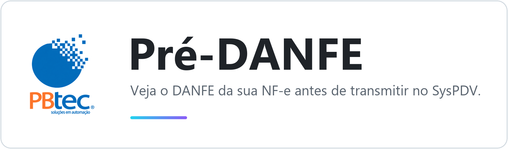

<p align="center">
  <picture>
    <source media="(prefers-color-scheme: dark)" srcset="docs/capa-escura.png">
    
  </picture>
</p>

# Pré-DANFE SysPDV

Gera um PDF no layout oficial do DANFE, com a marca **"SEM VALOR FISCAL – PRÉ-VISUALIZAÇÃO"**,
de NF-e (modelo 55) digitadas no **SysPDV** e ainda **não transmitidas**.
Serve para conferir a nota (itens, impostos, cliente) antes de transmitir.

O programa só **lê** o banco Firebird do SysPDV — nunca grava nada nele.

## Programas

| Programa | O que faz |
|---|---|
| `PreDANFE.exe` (V1) | Digite o número da NF-e e clique em **Gerar Pré-DANFE**. A janela também lista as notas pendentes (clique em uma para gerar). |
| `PreDANFE-Automatico.exe` (V2) | Fica perto do relógio e gera sozinho o PDF de toda NF-e nova ou alterada ainda não transmitida (`PreDANFE_<número>.pdf`). |
| `PreDANFE.bat` | Versão de linha de comando: lista as pendentes, você digita a linha e o PDF abre. |

Instruções para o usuário final: [`docs/LEIA-ME.txt`](docs/LEIA-ME.txt) (vai junto na pasta `Distribuir`)
e o manual em PDF gerado por `predanfe/manual/gerar_manual.py`.

## Estrutura

```
PreDanfe/
├── PreDANFE.bat            atalho da linha de comando
├── requirements.txt        dependências Python
├── docs/
│   ├── LEIA-ME.txt         instruções para o usuário final
│   ├── capa-*.png          faixa do topo deste README (manual/capa_readme.py)
│   └── referencia-visual/  ícones SVG que o tema.py redesenha
└── predanfe/               código-fonte
    ├── app_v1.py           janela V1 (sob demanda)
    ├── app_v2.py           V2 automático (ícone na bandeja)
    ├── predanfe.py         linha de comando
    ├── gerador.py          núcleo comum: busca a nota, monta e gera o PDF
    ├── banco.py            conexão somente leitura com o Firebird
    ├── nfe_xml.py          monta o XML da NF-e a partir das tabelas
    ├── tributos_aprox.py   tributos aproximados (IBPT) aprendidos das notas
    ├── tema.py             visual (cores, ícones, botões, claro/escuro)
    ├── tela_config.py, tela_sobre.py, menu_bandeja.py, util_app.py
    ├── validar.py          conferência contra as notas autorizadas
    ├── diagnostico.py      mostra os campos crus de uma nota
    ├── build.py            compila os .exe e monta a pasta Distribuir/
    ├── versao.py           versão e créditos
    ├── config.exemplo.ini  modelo do config.ini
    ├── fbclient/           cliente Firebird 5.0 64 bits (vai embutido nos .exe)
    ├── recursos/           ícone e logos
    └── manual/             gerador do manual em PDF (com dados fictícios)
```

## Instalação para desenvolvimento

1. Python 3.12 **64 bits** (python.org), marcando "Add python.exe to PATH".
2. Instale as dependências:
   ```bash
   python -m pip install -r requirements.txt
   ```
3. Copie `predanfe/config.exemplo.ini` para `predanfe/config.ini` e preencha a senha do banco.
4. `fbclient` no `config.ini`: em branco usa o `fbclient.dll` da pasta `predanfe/fbclient`;
   se preencher, precisa ser um **64 bits** (ex.: o do Firebird 5.0 instalado).

## Uso pela linha de comando

Dentro de `predanfe/`:

- `python predanfe.py` – lista as pendentes e pergunta qual gerar.
- `python predanfe.py --numero 4194` – gera direto a nota 4194.
- `python predanfe.py --numero 4194 --xml` – salva também o XML montado.
- `python predanfe.py --numero 4149 --comparar` – nota já transmitida: gera o
  pré-DANFE e o DANFE do XML oficial para comparar.

Os PDFs ficam em `predanfe/pdf` (configurável em `[saida] pasta_pdf`).

## Compilar os .exe

```bash
python predanfe/build.py
```

Gera `Distribuir/PreDANFE.exe`, `Distribuir/PreDANFE-Automatico.exe` e copia o `LEIA-ME.txt`.
Para refazer o manual: `python predanfe/manual/capturas.py` e depois
`python predanfe/manual/gerar_manual.py` (grava `Distribuir/Manual-PreDANFE.pdf`).

## Conferência

- `python validar.py` – monta o XML de todas as notas já autorizadas a partir
  das tabelas e compara com o XML oficial, campo a campo.
- `python validar.py --antes pdf\PreDANFE_4194_xxx.xml --numero 4194` – depois
  de transmitir uma nota, compara o pré-DANFE salvo antes com o XML final.

Resultado: com o histórico só até cada nota, 146 de 178 idênticas; com todo o
histórico (uso real), 161 de 178.

## Valores que o SysPDV só calcula na transmissão

O pré-DANFE calcula como ele (conferido com as notas autorizadas):

- **PIS/COFINS** (CST 01): base gravada × alíquota do regime (`PROPRIO.PRPREGFED`:
  R = 1,65%/7,60%; P = 0,65%/3,00%), meio centavo exato arredonda para baixo.
- **Tributos aproximados (IBPT)** — `tributos_aprox.py`: o SysPDV não grava os %
  (tabela NCM zerada; o arquivo `C:\Syspdv\<versão>.ibpt` é de 2024). Os % de cada
  NCM são aprendidos das notas transmitidas: item = arred(base×federal) +
  arred(base×estadual); o texto "Val Aprox Tributos..." usa um par próprio por NCM.
  NCM sem histórico: federal do arquivo .ibpt + estadual mais comum (marcado como estimado).
- **Texto das informações complementares**: sem acentos, hífen vira espaço;
  "Valor Total FCP: R$ x" quando há FCP; devolução recebe "Valor do IPI" e "Nota Ref.".
- **Fatura** sem linhas de duplicata (o SysPDV só lista a fatura).
- Devolução (finalidade 4) não leva tributos aproximados.

## Como a nota pendente é reconhecida

`NOTAFISCAL` com `NFSTIP <> 'CAN'`, `NFSSTATNFE` vazio e sem XML (`NFSXMLEMINFE`).
Notas transmitidas ficam com `NFSSTATNFE = 'AU'`; canceladas, `NFSACAONFE = 'CA'`.

## Segurança

- Toda consulta usa transação **somente leitura** do Firebird e termina em rollback.
- Nenhum arquivo da pasta `C:\Syspdv` é alterado.
- Da tabela `PROPRIO` só são lidos dados cadastrais (nunca senhas nem certificado).
- A senha do banco fica apenas no `config.ini` local, que não vai para o Git.

## Créditos

PBtec – Soluções em Automação · (83) 3224-3080
Desenvolvimento: Erick Henrique e José Henrique.
